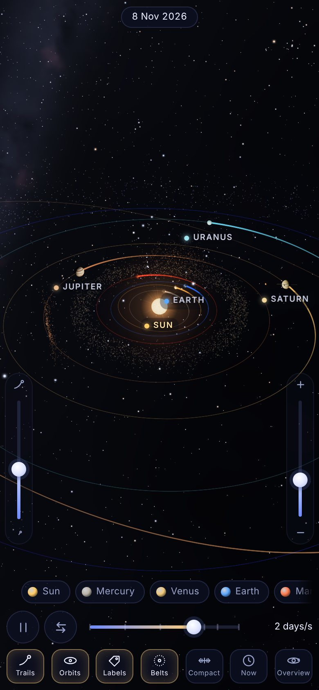
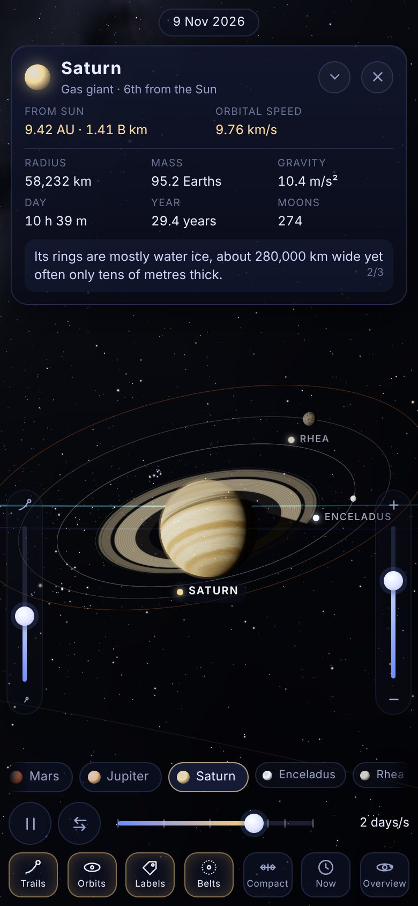
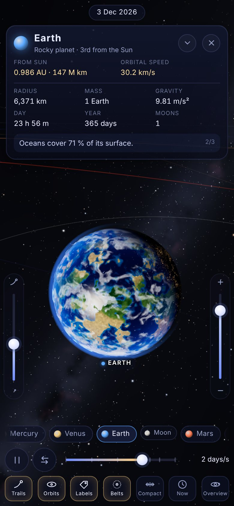
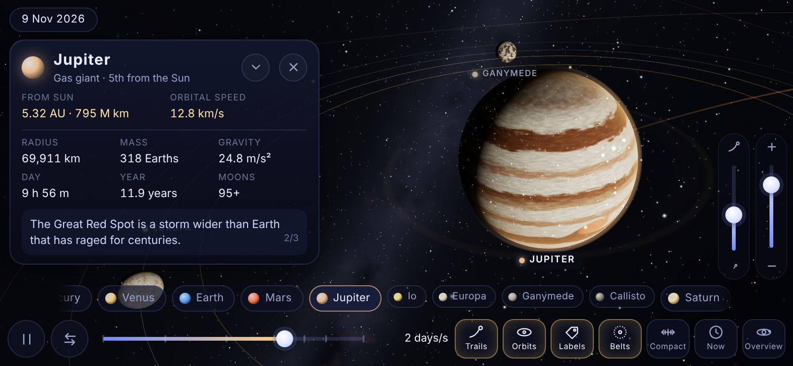

# Planet 3D

An offline 3D solar system for your phone. The Sun, eight planets, Pluto and fifteen
major moons orbit on their **real orbits for today's date**. You can speed time up,
slow it down or run it backwards, and tap any world to fly to it and read about it.
It runs as an installable web app (Add to Home Screen) and as an Android app built with
Capacitor and Gradle. After installation it never needs a connection.

| Overview | Saturn | Earth | Landscape |
| --- | --- | --- | --- |
|  |  |  |  |

## What's inside

- **Real orbital mechanics.** Planet positions come from JPL's Keplerian elements
  (Standish), solved with Kepler's equation every frame. The test suite checks them against a
  high-precision ephemeris. Orbits are inclined and eccentric, axial tilts and rotation poles
  follow the IAU values, Venus, Uranus and Pluto spin backwards, and Triton orbits retrograde. The
  Moon's phase matches the real sky. Jupiter's Trojans travel 60° ahead of and behind Jupiter.
- **Adjustable simulation speed.** A logarithmic slider runs from real time to one year per
  second, with snap points at 1 min/s, 1 h/s, 1 day/s, 1 week/s, 1 month/s and 1 year/s.
  There's also reverse, pause, and **Now**, which sweeps the planets smoothly back to the present.
- **Tap-to-focus camera.** Tap a planet, a label or a chip. The camera eases there on a
  curved path, arriving at a sunlit three-quarter view, then rides along with the body as it
  orbits. Drag to orbit (with inertia), pinch to zoom, twist with two fingers to turn.
  **Overview** flies back out.
- **Orbital trails.** Each planet draws a glowing, tapering trail along its orbit. It's computed
  from the orbit itself rather than recorded, so it stays smooth at any speed, paused or in
  reverse. A slider sets trail length. Faint orbit ellipses can be toggled, and moon orbits
  appear around the planet you're visiting.
- **Labels** follow the bodies on screen. They declutter by priority, hide behind nearer planets
  and never sit under the controls.
- **Info panels.** Every body has a compact card with live values (distance from the Sun and
  from Earth, light travel time, orbital speed) plus radius, mass, gravity, day, year, moons,
  tilt and temperature, and rotating facts. Expand it for details or tuck it away. The view
  re-centres so the card never covers the planet.
- **Space look.** The worlds are painted procedurally on the GPU at start-up: Jupiter's belts
  and Great Red Spot, Saturn's hexagon, Earth's continents, clouds and city lights, Pluto's heart,
  Io's volcanoes, Europa's cracks and more. Lighting is per-pixel from the Sun, with atmosphere
  rims, ocean glint, ring shadows on Saturn and Saturn's shadow across its rings, real eclipses
  (moon shadows on planets, red-tinted lunar eclipses), an animated Sun with corona, and the
  asteroid belt (with Kirkwood gaps), Trojans and Kuiper Belt.
- **Background sky.** The 8,404 real stars of the Yale Bright Star Catalogue sit at their true
  positions with their true colours, with a baked Milky Way along the galactic plane, so Orion,
  Scorpius and the rest are where they belong relative to the planets.
- **Two distance scales.** *Compact* (the default) brings the outer planets in. *True* morphs
  everything smoothly to real relative distances. Sizes stay enlarged so worlds remain visible.
- **Phone-first chrome.** Small thumb buttons along the bottom, on-screen sliders at the
  screen edges and no menus over the scene. Double-tap empty space to hide all controls, and
  double-tap again to bring them back. The layout respects notches and gesture bars, and has a
  dedicated landscape arrangement.
- **Smooth on phones.** Frame-rate-independent easing everywhere. Pixel ratio adapts to hold
  frame rate, textures bake progressively and are rebuilt after a GPU context loss, and the app
  pauses when hidden.

## Controls

| Action | How |
| --- | --- |
| Orbit the view | Drag with one finger (flick for inertia) |
| Zoom | Pinch, the right-hand slider, mouse wheel, `+` / `-` |
| Focus a body | Tap it, its label, or its chip in the strip (moons appear under their planet) |
| Pause / play | ⏸ button or `Space` |
| Speed | Bottom slider or `←` / `→` |
| Run backwards | ⇄ button or `R` |
| Trails / Orbits / Labels / Belts | Thumb buttons, or `T` / `O` / `L` / `B` |
| Trail length | Left-hand slider (shown while trails are on) |
| Compact ↔ true distances | **Compact/True** button or `S` |
| Back to today | **Now** or `N` |
| Back to the whole system | **Overview**, `H`, `Esc`, or the Android back button |
| Hide all controls | Double-tap empty space |
| Jump to a planet | `0` (Sun) … `9` (Pluto) |

## Install it on a phone

### Android app (Capacitor + Gradle)

Every push runs the **Android** workflow (`.github/workflows/android.yml`), which builds
`planet-3d-debug.apk`. Download it from the workflow run's *Artifacts*, open it on the phone
and allow installing from that source. Push a tag such as `v1.0.0` and the APKs are also
attached to a GitHub release.

To build a signed release (APK and Play Store bundle), add these repository secrets:
`PLANET3D_KEYSTORE_BASE64` (`base64 -w0 your.jks`), `PLANET3D_KEYSTORE_PASSWORD`,
`PLANET3D_KEY_ALIAS` and `PLANET3D_KEY_PASSWORD`. Locally you can put the same values in
`android/keystore.properties` (`storeFile`, `storePassword`, `keyAlias`, `keyPassword`),
which is git-ignored.

### Add to Home Screen (any phone)

The web build is a full Progressive Web App: a manifest with regular and maskable icons, an
Apple touch icon, iOS standalone meta tags and a service worker that precaches every file.
It needs to be served over HTTPS once:

1. Enable **Settings → Pages → Source: GitHub Actions** in this repository, then run
   **Actions → Deploy to GitHub Pages** (it also runs on every push to `main`).
2. Open the published URL on the phone.
3. **Android (Chrome):** tap the **Install** thumb button that appears, or ⋮ → *Install app*.
   **iPhone/iPad (Safari):** Share → *Add to Home Screen*.

It then launches full screen from the home screen and works in airplane mode. Any static
HTTPS host works the same way: upload the `dist/` folder.

## Building from source

Requirements: Node.js 22+, and for Android: JDK 21 and the Android SDK (platform 36).

```sh
npm ci
npm run dev            # live-reloading dev server (http://localhost:5173)
npm test               # unit tests: orbits vs. ephemeris, scale, moons, formatting
npm run build          # production web build in dist/ (+ generated service worker)
npm run test:e2e       # headless-Chromium smoke test incl. offline reload (after build)

# Android
npx cap sync android                     # copy dist/ into the native project
cd android && ./gradlew assembleDebug    # -> android/app/build/outputs/apk/debug/app-debug.apk
# or: npm run android:debug  /  npm run android:release (needs signing config)
```

Open `android/` in Android Studio to run on a device or emulator. The app id is
`com.samplatypus.planet3d`.

Other tools: `npm run icons` re-renders every icon and Android launcher/splash image from one
SVG design (uses Playwright's Chromium). `npm run stars -- <path/to/stars.json>` repacks the
star catalogue from Star Sky's data file.

## How it's put together

```
src/
  sim/        astro.js (time, Kepler solver, frames) · system.js (positions, moons, spin,
              trails) · scale.js (compact/true mapping) · speed.js
  data/       bodies.js (physical/orbital data, facts) · stars.js (packed star catalogue)
  render/     baker.js + glsl/bake.js (procedural textures on the GPU) · materials.js
              (planet, cloud, atmosphere, ring, Sun, sky, star, belt shaders) · bodies-view.js
              · lines.js (screen-space fat lines for trails/orbits) · belts.js · rings.js · sky.js
  controls/   rig.js (touch orbit camera, fly-to, follow)
  ui/         ui.js · info.js · labels.js · slider.js · format.js
  app.js      scene, animation loop, actions · main.js (boot, PWA, Capacitor hooks)
android/      Capacitor 8 Android project (Gradle), with custom icons, splash and dark theme
public/       manifest.webmanifest, icons
```

Three.js (r187) is the only runtime library besides Capacitor's core. Everything (code, star
data, shaders) is bundled, and no request ever leaves the device.

## Accuracy notes

Positions are accurate to a few arc-minutes for 1800–2050 and degrade gracefully outside it.
The simulation runs from 1000 BCE to 5000 CE. Moon orbits are circular with real periods,
inclinations and (for the Moon and the Galilean moons) real phases. Moon distances and all
sizes are compressed for visibility; the info cards always show the real numbers. Moon counts
are confirmed moons as of 2025.

See [NOTICE.md](NOTICE.md) for data sources and third-party licences.
